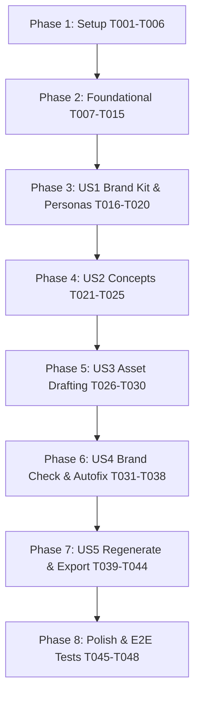

# Tasks: AI Marketing Campaign Generator

**Input**: Design documents from `/specs/001-campaign-generator/` (`spec.md`, `plan.md`, `research.md`, `data-model.md`, `contracts/api-contracts.json`, `quickstart.md`)

**Prerequisites**: `plan.md` (required), `spec.md` (required), `data-model.md`, `contracts/api-contracts.json`

**Tests**: Deterministic rule checking and validation logic MUST have mandatory unit tests covering boundaries, Unicode, and banned-word variants per Constitution Principle VIII. LLM wrapper fallback and end-to-end mock tests are also included.

**Organization**: Tasks are grouped by user story to enable independent implementation, testing, and demonstration of each story.

## Format: `- [ ] [TaskID] [P?] [Story?] Description with file path`

- **[P]**: Can run in parallel (different files, no dependencies)
- **[Story]**: Which user story this task belongs to (`[US1]`, `[US2]`, `[US3]`, `[US4]`, `[US5]`)
- Every task includes explicit target file paths.

## Path Conventions

- **Backend**: `backend/app/`, `backend/tests/`
- **Frontend**: `frontend/src/`
- **Data & Config**: `data/`, project root (`.env.example`, `.gitignore`, `README.md`)

---

## Phase 1: Setup (Shared Infrastructure)

**Purpose**: Project initialization, directory structure, environment configuration, and sample data.

- [X] T001 Initialize repository layout (`backend/app/prompts/`, `backend/tests/`, `frontend/src/components/`, `data/`) per `plan.md`
- [X] T002 Create root `.gitignore` isolating `.env`, `.venv`, `node_modules`, `dist`, `__pycache__`, and `.pytest_cache`
- [X] T003 [P] Create sanitized root `.env.example` documenting `OPENAI_API_KEY`, `WRITER_MODEL`, `JUDGE_MODEL`, `FALLBACK_API_KEY`, `FALLBACK_BASE_URL`, `FALLBACK_MODEL`, `MOCK_LLM`, `MAX_CONCURRENCY`, `ALLOWED_ORIGINS`
- [X] T004 [P] Create `backend/requirements.txt` with `fastapi>=0.110.0`, `uvicorn>=0.28.0`, `pydantic>=2.6.0`, `openai>=1.14.0`, `python-dotenv>=1.0.0`, `pytest>=8.0.0`, `pytest-asyncio>=0.23.0`
- [X] T005 [P] Create `data/sample.json` containing synthetic "SipSense" smart travel mug brand kit and three customer personas per `spec.md`
- [X] T006 Initialize React SPA with Vite, TypeScript, and Tailwind CSS in `frontend/package.json`, `frontend/vite.config.ts`, and `frontend/tailwind.config.js`

---

## Phase 2: Foundational (Blocking Prerequisites)

**Purpose**: Core schemas, deterministic rule engine, LLM client wrapper with dual-provider fallback, and base server setup. MUST be complete before user stories begin.

**⚠️ CRITICAL**: No user story work can begin until this phase is complete.

- [X] T007 Implement Pydantic v2 domain schemas (`BrandKit`, `ChannelRules`, `Persona`, `Concept`, `PostOutput`, `EmailOutput`, `RuleResult`, `JudgeResult`, `PieceResult`, `Campaign`) in `backend/app/schemas.py` per `data-model.md`
- [X] T008 [P] Implement environment settings loader with defaults in `backend/app/config.py`
- [X] T009 Implement deterministic rule checking engine in `backend/app/rules.py` (Unicode NFC normalization, char/word counts, hashtag parser, and regex banned word matcher with inflection suffixes and phrase variations)
- [X] T010 [P] Implement comprehensive unit tests for deterministic rules in `backend/tests/test_rules.py` covering boundary values (`exact`, `limit - 1`, `limit + 1`), Unicode/emojis, curly quotes, and banned-word variations (case, plurals, hyphens, spaces, hashtags)
- [X] T011 Implement LLM wrapper in `backend/app/llm.py` with `asyncio.Semaphore(MAX_CONCURRENCY)`, exponential backoff retry helper, OpenAI primary routing, Google Gemini fallback routing, and canned mock response generation (`MOCK_LLM=true`)
- [X] T012 [P] Implement LLM wrapper tests in `backend/tests/test_llm.py` validating mock mode, invalid JSON retry on the same provider, and primary failure fallback routing
- [X] T013 Create base FastAPI application with CORS middleware and `GET /api/health` provider reachability endpoint in `backend/app/main.py`
- [X] T014 [P] Create TypeScript interfaces matching backend schemas in `frontend/src/types/index.ts`
- [X] T015 [P] Create base API fetch client in `frontend/src/api/client.ts` with error handling and retry support

---

## Phase 3: User Story 1 - Set Up Brand Kit & Personas (Priority: P1)

**Story Goal**: Marketer loads or inputs a brand kit and three personas, and can edit any field at runtime without restarting.

**Independent Test**: Load the application, click "Load Sample Data", edit a channel limit or persona pain point, and verify updates persist in memory and are sent in subsequent requests.

- [X] T016 [US1] Implement `GET /api/sample` endpoint in `backend/app/main.py` to serve synthetic data from `data/sample.json`
- [X] T017 [P] [US1] Create Stepper navigation component in `frontend/src/components/Stepper.tsx` supporting 4 linear steps (Setup, Concepts, Campaign, Export)
- [X] T018 [P] [US1] Create `BrandKitForm.tsx` in `frontend/src/components/BrandKitForm.tsx` with inputs for brand/product name, tagline, voice summary, tag inputs for banned terms, example lines, product features, and number inputs for channel limits
- [X] T019 [P] [US1] Create `PersonaCard.tsx` in `frontend/src/components/PersonaCard.tsx` with editable fields for role, motivations, tone, pain points, and a warning indicator if two personas share their first pain point
- [X] T020 [US1] Assemble Setup view in `frontend/src/components/SetupView.tsx` with "Load Sample Data" action and state bindings to root `frontend/src/App.tsx`

---

## Phase 4: User Story 2 - Get Campaign Concepts (Priority: P2)

**Story Goal**: Marketer requests concepts and receives exactly 3 distinct concepts (name, key message, hook) verified free of banned words, and picks one.

**Independent Test**: Request concepts from the loaded brand kit, verify 3 distinct concept cards render with zero banned words, and click "Pick this Concept" to advance the stepper.

- [X] T021 [US2] Implement isolated concept generation prompt template in `backend/app/prompts/concepts.py` with clearly delimited data sections
- [X] T022 [US2] Implement `generate_concepts()` step in `backend/app/steps.py` that calls LLM wrapper with temperature ~0.9, validates 3 concepts with Pydantic, checks banned words with `rules.py`, and retries once on rule violation
- [X] T023 [US2] Implement `POST /api/concepts` endpoint in `backend/app/main.py` taking `ConceptsRequest` and returning `ConceptsResponse`
- [X] T024 [P] [US2] Create `ConceptCard.tsx` in `frontend/src/components/ConceptCard.tsx` rendering concept title, key message, creative hook, and a "Pick this Concept" action
- [X] T025 [US2] Assemble Concepts view in `frontend/src/components/ConceptsView.tsx` connecting API call, loading skeletons, error retry dialogs, and selection state transition in `frontend/src/App.tsx`

---

## Phase 5: User Story 3 - Get Tailored Assets per Persona (Priority: P3)

**Story Goal**: Generate tailored social post and email copy for all 3 personas side-by-side, each leading with distinct pain points and sticking to factual product claims.

**Independent Test**: Advance to Campaign step, verify 3 columns render in parallel, and confirm that each persona's copy visibly leads with that persona's first pain point without reusing another persona's leading pain point.

- [X] T026 [US3] Implement piece writing prompt template in `backend/app/prompts/write_piece.py` with ordered sections: role, brand voice, allowed features, persona profile, lead angle, avoid angles, chosen concept, and channel limits with safety margin
- [X] T027 [US3] Implement `write_piece()` step in `backend/app/steps.py` calling LLM wrapper with temperature ~0.8 to produce schema-validated `PostOutput` or `EmailOutput`
- [X] T028 [US3] Implement pain point routing helper in `backend/app/steps.py` ensuring each persona is assigned its primary pain point and provided a list of other personas' lead pain points to avoid
- [X] T029 [US3] Implement basic `POST /api/piece` drafting endpoint in `backend/app/main.py` assembling post body and hashtags into `assembled_text`
- [X] T030 [P] [US3] Create 3-column comparative persona container in `frontend/src/components/CampaignView.tsx` with individual loading states per card

---

## Phase 6: User Story 4 - See Brand Check & Auto-Fix on Every Piece (Priority: P4)

**Story Goal**: Every piece shows a brand-fit score (1-5), explanation, and itemized rule results. If a rule fails or score <= 2, auto-fix once and label with "Fixed automatically" or display exact broken rules.

**Independent Test**: Generate copy with a tightened limit or banned word; observe the automated fix attempt, verify the "Fixed automatically" badge on success, or observe prominent red failure styling with exact rule and measurement details on stubborn failures.

- [X] T031 [US4] Implement judge prompt template in `backend/app/prompts/judge.py` with low temperature (~0.1) and rubric (5=Unmistakable to 1=Off-brand), ordering `reason` strictly before `score`
- [X] T032 [US4] Implement `judge_piece()` step in `backend/app/steps.py` returning schema-validated `JudgeResult`
- [X] T033 [US4] Implement auto-fix prompt template in `backend/app/prompts/autofix.py` accepting original piece text and itemized failed rules with matched offending text
- [X] T034 [US4] Implement `autofix_piece()` step in `backend/app/steps.py` executing exactly one remediation attempt
- [X] T035 [US4] Implement full pipeline orchestrator `run_piece()` in `backend/app/pipeline.py` executing: write -> rules check -> judge -> if broken rule or score <= 2: auto-fix -> re-check rules -> re-judge -> return `PieceResult` with status (`pass`, `fixed`, or `failing`) and `provider` tag
- [X] T036 [US4] Update `POST /api/piece` in `backend/app/main.py` to route through `pipeline.run_piece()`
- [X] T037 [P] [US4] Create `PieceCard.tsx` in `frontend/src/components/PieceCard.tsx` displaying assembled text, score badge with reasoning popover, rule pass/fail list, "Fixed automatically" badge, and failure diagnostics
- [X] T038 [US4] Update `CampaignView.tsx` in `frontend/src/components/CampaignView.tsx` to render `PieceCard` components in 3 columns (Social Post and Email rows per persona)

---

## Phase 7: User Story 5 - Regenerate and Export (Priority: P5)

**Story Goal**: Regenerate single pieces independently, regenerate all pieces simultaneously using current edited brand rules/personas, and export the campaign in Markdown or JSON format.

**Independent Test**: Click "Regenerate" on Persona 1's email and verify only that card refreshes; click "Regenerate All" and verify all 6 pieces update; download both `.md` and `.json` export files and verify complete hierarchy.

- [X] T039 [US5] Implement export generation logic in `backend/app/export.py` converting complete `Campaign` payload into formatted Markdown and structured JSON strings
- [X] T040 [US5] Implement `POST /api/export` endpoint in `backend/app/main.py` accepting `ExportRequest` and returning `ExportResponse`
- [X] T041 [US5] Add single-piece regenerate action to `PieceCard.tsx` in `frontend/src/components/PieceCard.tsx` dispatching single `POST /api/piece` request
- [X] T042 [US5] Add "Regenerate All" action to `CampaignView.tsx` in `frontend/src/components/CampaignView.tsx` re-dispatching all 6 parallel requests with current brand kit and personas
- [X] T043 [P] [US5] Create `ExportView.tsx` in `frontend/src/components/ExportView.tsx` with one-click download buttons for Markdown and JSON formats
- [X] T044 [US5] Connect Export step in `frontend/src/App.tsx` passing active campaign state to `ExportView.tsx`

---

## Phase 8: Polish & Cross-Cutting Concerns

**Purpose**: End-to-end integration testing in mock mode, projector-ready UI styling, failure dialogs, and comprehensive documentation.

- [X] T045 Create end-to-end mock pipeline integration test in `backend/tests/test_e2e_mock.py` simulating full workflow from sample loading, concept generation, piece generation with forced auto-fix, and export
- [X] T046 [P] Add interactive API error alert dialog in `frontend/src/components/ErrorDialog.tsx` with "Retry" and "Switch to Offline Mock Mode" actions per Spec Clarification
- [X] T047 [P] Apply high-contrast projector typography styling, responsive spacing, and badge palettes in `frontend/src/index.css`
- [X] T048 Create comprehensive `README.md` at repository root documenting project overview, architecture, `.env` setup, mock mode instructions, and rule engine design

---

## Dependencies & Execution Graph

### Story Dependencies
- **Foundational (Phase 2)** blocks all user stories.
- **US1 (Phase 3)**: Independent after Foundational. Delivers MVP baseline (setup & editable brand/persona state).
- **US2 (Phase 4)**: Depends on US1 (requires brand kit & personas).
- **US3 (Phase 5)**: Depends on US2 (requires chosen concept).
- **US4 (Phase 6)**: Depends on US3 (evaluates & fixes drafted assets).
- **US5 (Phase 7)**: Depends on US4 (exports verified pieces and provides regeneration).
- **Polish (Phase 8)**: Depends on US5 (validates end-to-end flows).

---

## Parallel Execution Opportunities

### Within Phase 1 (Setup)
- `T003` (.env.example), `T004` (requirements.txt), `T005` (sample.json) can run in parallel.

### Within Phase 2 (Foundational)
- `T008` (config.py), `T010` (test_rules.py), `T012` (test_llm.py), `T014` (types/index.ts), and `T015` (client.ts) can execute in parallel once `T007` (schemas) and `T009` (rules) are in place.

### Within Phase 3 (US1)
- `T017` (Stepper.tsx), `T018` (BrandKitForm.tsx), and `T019` (PersonaCard.tsx) can build in parallel.

### Within Phase 4 (US2)
- `T024` (ConceptCard.tsx) can build in parallel with `T022` (generate_concepts step) and `T023` (API endpoint).

### Within Phase 6 (US4)
- `T031` (judge prompt) and `T033` (autofix prompt) can build in parallel.
- `T037` (PieceCard.tsx) can build in parallel with backend pipeline integration (`T035`).

### Within Phase 7 (US5)
- `T039` (export.py) and `T043` (ExportView.tsx) can build in parallel.

---

## Implementation Strategy

### MVP First (User Story 1 + Story 2 + Story 3 Mock)
1. Complete **Phase 1: Setup** and **Phase 2: Foundational**.
2. Complete **Phase 3: User Story 1**. Validate that sample data loads, edits work, and persistence functions.
3. Complete **Phase 4: User Story 2** in mock mode. Verify 3 concepts generate and selection works.
4. Complete **Phase 5: User Story 3** and **Phase 6: User Story 4** in mock mode. Verify 3-column asset display, rule checks, and auto-fix work end-to-end.

### Incremental Delivery & Demo Readiness
- Every increment maintains a working application on `main`.
- `MOCK_LLM=true` allows full UI and pipeline development with zero network or external API spending.
- Live LLM providers (OpenAI primary + Gemini fallback) are connected and verified once the pipeline structure is locked.
